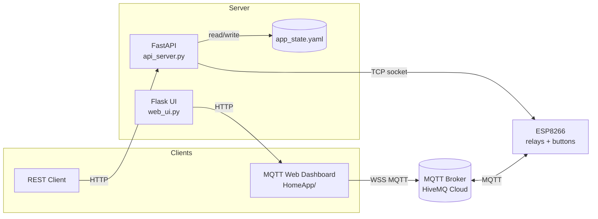

# Smart Home Server (espServer)

> A FastAPI REST API and web UI for controlling ESP8266-based home-automation relays over TCP and MQTT.

## Overview

`espServer` is a small home-automation control stack. A FastAPI service exposes a
REST API that talks to an ESP8266 microcontroller over a raw TCP socket to toggle
relays and track their state in a YAML config file. A separate browser dashboard
(`HomeApp/`) controls the same relays directly over MQTT (HiveMQ Cloud) using
MQTT.js. The repository also includes the matching Arduino firmware for the
ESP8266 in two variants: one that speaks TCP and one that speaks MQTT.

The project demonstrates two independent control paths to the same hardware:

- **REST + TCP path** — `api_server.py` ⇄ `btnRebounceTCP.ino`
- **Web + MQTT path** — `HomeApp/` ⇄ `btnRebounceMQTT.ino`

## Key Features

- REST API (FastAPI) to connect/disconnect, toggle relays, and read relay/connection state.
- Persistent state stored in `Configs/app_state.yaml` via YAML read/write/update helpers.
- CORS enabled for browser-based clients.
- Config reset endpoint and a log-tail endpoint.
- Standalone MQTT web dashboard with live relay state, connection status, and toggle controls.
- ESP8266 firmware with hardware-button debouncing and EEPROM-persisted relay state (MQTT variant).
- A minimal Flask app (`web_ui.py`) for serving a templated UI.

## Tech Stack

- **Backend:** Python, FastAPI, Pydantic, Uvicorn (ASGI), Flask
- **Config:** PyYAML (`Configs/app_state.yaml`)
- **Frontend:** HTML, CSS, vanilla JavaScript, MQTT.js (WebSocket MQTT)
- **Messaging:** MQTT over WebSocket (HiveMQ Cloud)
- **Firmware:** Arduino C++ for ESP8266 (`ESP8266WiFi`, `PubSubClient`, `EEPROM`)

## Architecture



## Setup

Requires Python 3.10+ (the code uses `str | list` type unions).

```bash
# from the repository root
python -m venv .venv
source .venv/bin/activate          # Windows: .venv\Scripts\activate
pip install -r requirements.txt
```

### Configure secrets

The MQTT dashboard reads credentials from `HomeApp/mqtt_secrets.js`, which exports
`MQTT_BROKER`, `MQTT_USER`, and `MQTT_PASS`. The ESP firmware reads WiFi/MQTT
credentials (`ssid`, `password`, `mqtt_server`, `mqtt_port`, `mqtt_user`,
`mqtt_pass`) from a `secrets.h` file (not committed). Provide your own values
before running.

The TCP target device IP/port live in `Configs/app_state.yaml` under `esp:`.

## Run

Run the REST API with Uvicorn:

```bash
uvicorn api_server:app --host 0.0.0.0 --port 8000
```

Run the Flask UI (optional):

```bash
python web_ui.py        # serves on http://0.0.0.0:8080
```

Serve the MQTT dashboard (`HomeApp/`) with any static file server, e.g.:

```bash
python -m http.server 5500 --directory HomeApp
```

Flash the appropriate `.ino` firmware (`btnRebounceTCP.ino` or
`btnRebounceMQTT.ino`) to the ESP8266 using the Arduino IDE.

## Usage Example

```bash
# Connect to the ESP over TCP
curl -X POST http://localhost:8000/connect

# Toggle relay 1
curl -X POST http://localhost:8000/relay/toggle \
     -H "Content-Type: application/json" \
     -d '{"relay_num": 1}'

# Read all relay states
curl http://localhost:8000/relays
```

### REST endpoints

| Method | Path                     | Description                          |
|--------|--------------------------|--------------------------------------|
| POST   | `/connect`               | Open TCP connection to the ESP       |
| POST   | `/disconnect`            | Close the TCP connection             |
| POST   | `/relay/toggle`          | Toggle a relay (`{"relay_num": N}`)  |
| GET    | `/relay/{relay_num}/state` | Get a single relay's state         |
| GET    | `/relays`                | Get all relay states                 |
| GET    | `/logs`                  | Tail the last 20 lines of the log    |
| POST   | `/reset`                 | Reset config to defaults             |
| GET    | `/esp/connection`        | Get current connection state         |

## Limitations / Next Steps

- Credentials are currently hardcoded in `HomeApp/mqtt_secrets.js` and in
  `btnRebounceTCP.ino`; move all secrets out of source control before sharing.
- CORS is set to allow all origins (`*`) — restrict for production.
- The REST/TCP path and the MQTT path do not share state; the FastAPI YAML state
  is not updated by MQTT-driven changes.
- The TCP `client_socket` is a single in-memory global with no reconnect/retry logic.
- `web_ui.py` renders `templates/index.html`, but only `templates/style.css` is
  present in `templates/`; the static UI lives in `HomeApp/`.
- The `/logs` endpoint expects logs under `~/Library/Logs/LuluApp/Logs` (macOS path).
- Relay count is fixed at two (`relay_1`, `relay_2`).
